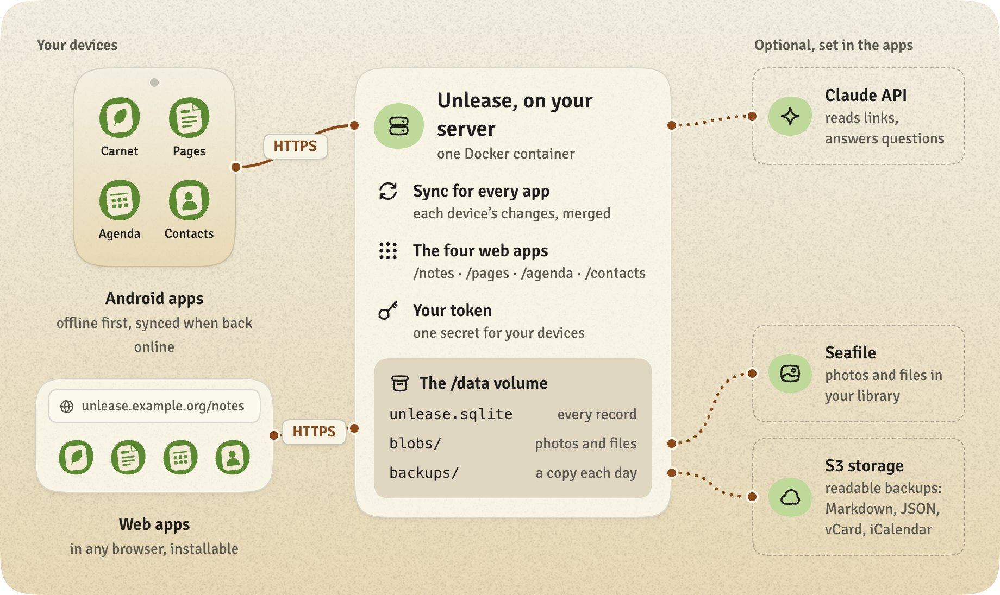

<p align="center">
  
</p>

<h1 align="center">Unlease</h1>

<p align="center">
  <b>Stop leasing your data to Google, and unleash yourself.</b><br>
  Notes, pages, a calendar and contacts on your own server: four apps that replace Google's, on the web and on Android.
</p>

<p align="center">
  <a href="https://demo.unlease.org/?lang=en"><b>Try the demo</b></a> ·
  <a href="#install">Install</a> ·
  <a href="https://github.com/stephenprn/unlease/releases/latest">Download</a> ·
  <a href="docs/README.md">Documentation</a> ·
  <a href="CHANGELOG.md">Changelog</a>
</p>

<p align="center">
  <a href="https://github.com/stephenprn/unlease/releases/latest"></a>
  <a href="https://github.com/stephenprn/unlease/actions/workflows/ci.yml"></a>
  <a href="LICENSE"></a>
  <a href="https://github.com/stephenprn/unlease/pkgs/container/unlease"></a>
</p>

<p align="center">
  <a href="https://demo.unlease.org/?lang=en"><picture><source media="(prefers-color-scheme: dark)" srcset="docs/images/banner-dark.jpg"></picture></a>
</p>

Unlease is a suite of apps you run on your own server, each replacing one of Google's: **Carnet** for Keep, **Pages** for Docs (and Notion), **Agenda** for Calendar and **Contacts** for Contacts. One container runs the apps you pick. They share one setup, one look and one place for your settings, and what you keep in one shows up in the others: a page embeds a checklist, a birthday lands in the calendar, a reminder sits beside your meetings.

- **Yours.** One server you run, one SQLite file, a copy of it every day, and backups to any S3 storage you can read without Unlease (Markdown, JSON, vCard, iCalendar). No analytics, no tracker.
- **Everywhere.** Each app on Android, offline first and synced when the network returns, and on the web, installable, with keyboard shortcuts. In French or English, in the colours you pick.
- **Clever where it helps.** With your own Claude API key, the links you save are read, summarised and filed, and you can ask about your pages or your week. Optional, within a monthly budget you set.

The [demo](https://demo.unlease.org/?lang=en) runs the four web apps in your browser with made-up notes, pages, people and events, written in French (the interface follows your language): nothing leaves the browser, and every reload starts afresh. The pictures below come from it.

> [!WARNING]
> Unlease is young (0.x). Until 1.0, a minor version (0.2 to 0.3) may break things, and the [changelog](CHANGELOG.md) says what to do. The Android apps are APKs from the [releases](https://github.com/stephenprn/unlease/releases/latest), not on a store.

## The apps

###  Carnet

**Replaces Google Keep.** Notes, checklists, drawings and reminders on a wall of cards, and collections of links that Claude reads, summarises and files: each link keeps its picture, its shop and its price, and says when the price drops.

<p align="center">
  <a href="https://demo.unlease.org/notes/?lang=en"><picture><source media="(prefers-color-scheme: dark)" srcset="docs/images/carnet-dark.jpg"></picture></a>
</p>

<details>
<summary><b>Everything Carnet does</b></summary>

- **Notes and checklists**, Keep's way: a wall of cards, pinned and archived, labels, colours and papers, reminders, photos, drawings, undo and a bin. Moves in from a Google Keep export (Takeout).
- **Collections of links**: share a link from any app, or paste it, and Claude writes what matters (title, price, key facts, its pictures kept) and files it in the right collection, so your lists stay useful after the pages disappear.
- **Modules on links**, switched on per collection: promo codes, the same item cheaper elsewhere or second-hand, a recipe for N people with its shopping list and a cook mode, ratings, a series' recap up to where you stopped, the way to a place, a copy of an article kept as a page in Pages, a question to Claude.
- **On Android**: the share sheet, five home-screen widgets, and reminders that ring on time.

</details>

###  Pages

**Replaces Google Docs and Notion.** Nested pages of headings, tasks, tables with typed columns, pictures and drawings, citing and embedding your notes, links, people and events.

<p align="center">
  <a href="https://demo.unlease.org/pages/?lang=en"><picture><source media="(prefers-color-scheme: dark)" srcset="docs/images/pages-dark.jpg"></picture></a>
</p>

<details>
<summary><b>Everything Pages does</b></summary>

- **Nested pages** of headings, lists, tasks, toggles, callouts, code, tables with typed columns, side-by-side columns, pictures, videos, PDFs, files and drawings, with templates for a new page.
- **Your other apps inside**: Carnet's notes, collections and links cited inline or embedded as a list or a table; people and events mentioned with `@`; dates that show in Agenda.
- **Questions to Claude** about a page, its sub-pages or all your pages, each answer pointing at the passages it rests on. Off until you turn it on; a page you keep private is never sent.

</details>

###  Agenda

**Replaces Google Calendar.** Every view from the day to the year, repeating events, reminders and subscriptions, with your contacts' birthdays, Carnet's reminders and the public holidays beside your events.

<p align="center">
  <a href="https://demo.unlease.org/agenda/?lang=en"><picture><source media="(prefers-color-scheme: dark)" srcset="docs/images/agenda-dark.jpg"></picture></a>
</p>

<details>
<summary><b>Everything Agenda does</b></summary>

- **Day, three days, week, month, year, a schedule and Today**; repeating events and their exceptions, reminders, time zones, labels, places with their weather, guests from Contacts, files kept with an event.
- **Beside your events**: your contacts' birthdays (with a message or a gift idea a tap away), Carnet's reminders, the days written in your pages and your country's public holidays.
- **Calendars in and out**: subscribe to any calendar by its address (Google's secret iCal address included), import Google Calendar's export, publish yours at a secret address. Type an event in a few words, or ask Claude about your week; a meeting's notes become a page in one tap.
- **On Android**: five widgets (the schedule, today, the month, the next event and a countdown).

</details>

###  Contacts

**Replaces Google Contacts.** People, their numbers, addresses and birthdays, labels and favourites, moved in from Google; a call, a message or WhatsApp in one tap.

<p align="center">
  <a href="https://demo.unlease.org/contacts/?lang=en"><picture><source media="(prefers-color-scheme: dark)" srcset="docs/images/contacts-dark.jpg"></picture></a>
</p>

<details>
<summary><b>Everything Contacts does</b></summary>

- **An address book**: names, numbers, e-mails, addresses, birthdays, labels and favourites, imported from Google Contacts (vCard or CSV) or from the phone's own contacts; duplicates found and merged.
- **One tap** to call, text or open WhatsApp; birthday notifications and wishes; gift ideas kept in Carnet.
- **Where each person appears**: the pages and notes that mention them, the events you share.
- **On Android**: two widgets, quick calls to your favourites (or a label) and a new contact.

</details>

| | Carnet | Pages | Agenda | Contacts |
| --- | :-: | :-: | :-: | :-: |
| On the web | `/notes` | `/pages` | `/agenda` | `/contacts` |
| On Android, offline first | ✓ | ✓ | ✓ | ✓ |
| Home-screen widgets | 5 | – | 5 | 2 |
| Moves in from | Google Keep (Takeout) | – | Google Calendar (iCalendar) | Google Contacts (vCard, CSV), the phone |
| With Claude | reads and files links | answers about your pages | answers about your week | – |

## One suite, one person seen from every app

Each app keeps its own data, all of it on one server, so each can show what the others hold. Type `@` in a page or a note to mention a person or an event; embed a checklist or a whole collection of links in a page; see birthdays, reminders and the days written in your pages in your calendar; open a contact to find every page that mentions them. A launcher in every app's corner moves between them, and on Android the second app you install reuses the first one's connection.

<picture>
  <source media="(prefers-color-scheme: dark)" srcset="docs/images/links-dark.jpg">
  
</picture>

## How it runs

One Docker container serves the sync, the API and the four web apps on one port, behind the HTTPS you already have. The Android apps keep everything on the phone and sync when they can. Everything the server holds sits in one volume: the database, your photos and files, and a copy of the database every day. Claude, S3 and Seafile are optional, set from the apps' Administration.

<picture>
  <source media="(prefers-color-scheme: dark)" srcset="docs/images/run-dark.jpg">
  
</picture>

## Install

<picture>
  <source media="(prefers-color-scheme: dark)" srcset="docs/images/install-dark.jpg">
  
</picture>

You need a machine with Docker that your phone can reach over **HTTPS**: a home server behind a reverse proxy or a tunnel, or a small VPS. One container runs the whole suite, whatever apps you choose.

1. **Start the server**:

   ```bash
   mkdir unlease && cd unlease
   curl -fsSLO https://github.com/stephenprn/unlease/releases/latest/download/docker-compose.yml
   curl -fsSL -o .env https://github.com/stephenprn/unlease/releases/latest/download/example.env
   sed -i "s/^UNLEASE_TOKEN=.*/UNLEASE_TOKEN=$(openssl rand -hex 32)/" .env   # your token, in .env
   docker compose up -d
   ```

2. **Add HTTPS** in front of port 8080: [SELF-HOSTING.md](docs/SELF-HOSTING.md#https-in-front) has Caddy, nginx, Traefik and Cloudflare Tunnel.
3. **Run the setup**: open your address in a browser. It asks once, for every app: the token (`grep UNLEASE_TOKEN .env`), which apps to run, and optionally Claude, backups to S3 and files in Seafile. [Before you start](docs/SELF-HOSTING.md#before-you-start) lists everything it may ask and where you find it.
4. **Install the apps**: the web apps are already there. On Android, download the APK of each app you chose from the [latest release](https://github.com/stephenprn/unlease/releases/latest) (`carnet-vX.Y.Z.apk`, `pages-vX.Y.Z.apk`, `agenda-vX.Y.Z.apk`, `contacts-vX.Y.Z.apk`), open it on the phone (allow installing from your browser or file manager) and enter your server's address and token. Updates are new APKs from the releases, installed over the old ones.

**Back up** the volume's `backups/` and `blobs/` (never the live `unlease.sqlite`), or turn on Unlease's own S3 backups in the Administration: [your data](docs/SELF-HOSTING.md#your-data).

## Upgrade

Read the [changelog](CHANGELOG.md) up to the new version, then upgrade the server first: set `UNLEASE_VERSION` to it in `.env` and run `docker compose pull && docker compose up -d`. Then install the release's APKs; the web apps update with the server. [UPGRADING.md](docs/UPGRADING.md) explains why the server goes first, the version tags, and how to go back.

## Claude, costs and privacy

Claude is optional: without an API key every app works, Carnet keeps links as they are, unread, and the questions to Claude stay off. With a key (set once for every app, kept on your server, the only part that talks to Anthropic), a link costs roughly one to three cents to read, the server stops at the monthly budget you set, and your notes and pages are never sent to read a link.

<picture>
  <source media="(prefers-color-scheme: dark)" srcset="docs/images/privacy-dark.jpg">
  
</picture>

[PRIVACY.md](docs/PRIVACY.md) lists what each feature sends, when, and what it costs.

## Documentation

| | |
| --- | --- |
| [Self-hosting](docs/SELF-HOSTING.md) | Proxies, every setting, your data, backups, hosting a web app elsewhere |
| [Upgrading](docs/UPGRADING.md) | Versions, the server first, going back |
| [Privacy and costs](docs/PRIVACY.md) | What leaves your server, when, and what Claude costs |
| [Architecture](docs/ARCHITECTURE.md) | The suite, its apps and their data across apps, sync, Carnet's link reading |
| [Server API](server/README.md) | Every route, the configuration, the data on disk |
| [Changelog](CHANGELOG.md) | What changed in each release |

The full map, by what you need, is [docs/README.md](docs/README.md).

## Contributing

Issues and pull requests are welcome, in English or French. One repository holds the server, every app and the shared design system; to try a change, run the web apps on a server simulated in the page:

```bash
npm install
npm run dev -w web    # then open http://localhost:5173/notes?demo
```

[CONTRIBUTING.md](CONTRIBUTING.md) sets up the rest (the phone apps: [mobile/README.md](mobile/README.md)) and lists the checks. Please follow the [code of conduct](CODE_OF_CONDUCT.md); report a vulnerability privately as [SECURITY.md](SECURITY.md) says; [SUPPORT.md](SUPPORT.md) says where to ask a question. The README's pictures come from the demo and the design system: `npm run readme-images -w web` makes them again.

## Licence

[MIT](LICENSE).
