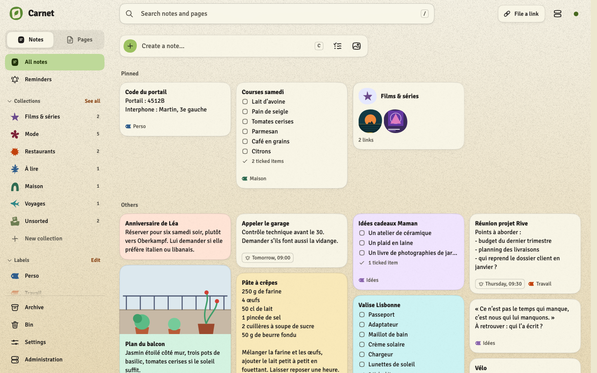
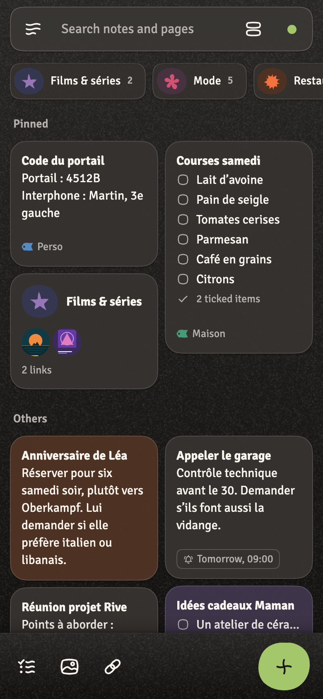
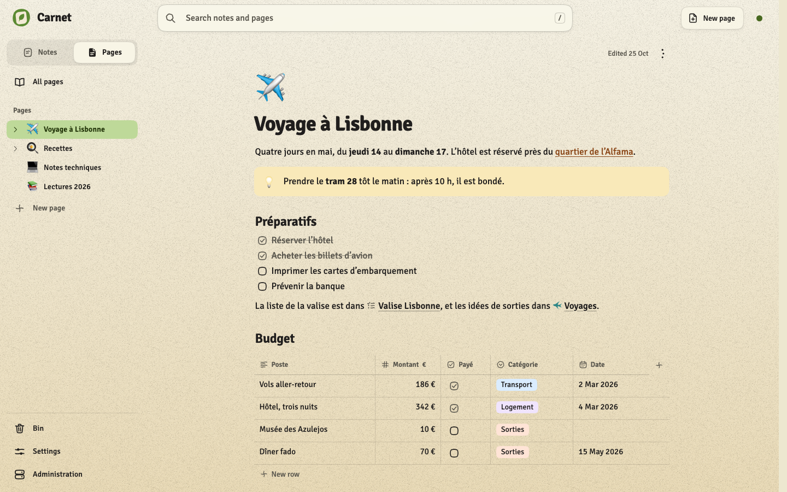

# Unlease

[](https://github.com/stephenprn/unlease/actions/workflows/ci.yml)
[](https://github.com/stephenprn/unlease/releases/latest)
[](LICENSE)

Stop leasing your data to Google, and unleash yourself. Unlease is a suite of apps that replaces Google's, on your own server: each app installs on its own, all of them share one server, one look and data that points from one app into another (a note will be able to mention an event of the calendar). No Google service, no analytics, no tracker.

Your data stays yours: one server you run, one SQLite file, backups to any S3 storage as a readable archive (Markdown and JSON), and your photos and files in a Seafile library if you want them there.

**Try it in your browser:** [the demo](https://stephenprn.github.io/unlease/), Carnet on the web with made-up notes and pages. Nothing leaves the browser, and every reload starts afresh.

> **Status: early (0.x).** Each release is one version for the server and every app. Until 1.0, a minor version (0.2 to 0.3) may break things; the [changelog](CHANGELOG.md) says what to do.

<p>
  
  
</p>


## The apps

**Carnet** (available): notes, checklists, pages and lists of links. A self-hosted Google Keep with a Notion-like side, and one difference that matters: every link you save is read by Claude, summarised (title, price, key facts, its pictures kept) and filed in the right collection, so your lists stay useful after the pages disappear.

- **Notes and checklists**, Keep's way: a wall of cards, pinned and archived, labels, colours and papers, reminders, photos, drawings, a bin. Imports a Google Keep export (Takeout).
- **Collections of links**: share a link from any app (or paste it) and Claude writes what matters and files it. Each collection can show small modules on its links: promo codes, the same item cheaper elsewhere or second-hand, a recipe for N people with its shopping list and a cook mode, ratings, a series' recap up to where you stopped, the way to a place, a copy of an article kept as a page, a question to Claude.
- **Pages**: a knowledge base with nested pages, headings, lists, tasks, toggles, callouts, code, tables with typed columns, pictures, videos, PDFs and files, and your notes, collections and links cited inline.
- **On Android** (offline first, the share sheet, five home-screen widgets, reminders as notifications) **and on the web** (served by your server, with keyboard shortcuts). In French or English, in the colours you pick.

**Next:** a calendar and contacts, linked to Carnet's notes and pages.

## Install

You need a machine with Docker that your phone can reach over **HTTPS** (a home server behind a reverse proxy or a tunnel, or a small VPS). One container runs the whole suite.

```bash
mkdir unlease && cd unlease
curl -fsSLO https://github.com/stephenprn/unlease/releases/latest/download/docker-compose.yml
curl -fsSL -o .env https://github.com/stephenprn/unlease/releases/latest/download/example.env
openssl rand -hex 32        # paste it as UNLEASE_TOKEN in .env
docker compose up -d
```

Both files come from the latest release, pinned to its version (`UNLEASE_VERSION` in `.env`). Put HTTPS in front of port 8080 ([docs/SELF-HOSTING.md](docs/SELF-HOSTING.md) has Caddy, nginx, Traefik and Cloudflare Tunnel), open the address in a browser and type the token: Carnet's web app opens, and its first run lists what the server can do on top (Claude, backups to S3, files in Seafile), each optional.

**Carnet on Android:** download `carnet-vX.Y.Z.apk` from the [same release](https://github.com/stephenprn/unlease/releases/latest), open it on the phone (allow installing from your browser or file manager), and enter your server's address and token. It is not on a store: updates are new APKs from the releases, installed over the old one.

## Upgrade

Read the [changelog](CHANGELOG.md) up to the new version, then upgrade the server first: set `UNLEASE_VERSION` to it in `.env` and run `docker compose pull && docker compose up -d`. Then install the release's APK; the web app updates with the server. [docs/UPGRADING.md](docs/UPGRADING.md) explains why the server goes first, the version tags, and how to go back.

## Claude, costs and privacy

Claude is optional: without an API key every app works, and Carnet keeps links as they are, unread. With a key (set from the apps' Administration, kept on your server, which is the only part that talks to Anthropic), a link costs roughly one to three cents to read, the server stops at the monthly budget you set, and your notes and pages are never sent to read a link. [docs/PRIVACY.md](docs/PRIVACY.md) lists what each feature sends and what it costs.

## Documentation

| | |
| --- | --- |
| [Self-hosting](docs/SELF-HOSTING.md) | Proxies, every setting, your data, backups, hosting a web app elsewhere |
| [Upgrading](docs/UPGRADING.md) | Versions, the server first, going back |
| [Privacy and costs](docs/PRIVACY.md) | What leaves your server, when, and what Claude costs |
| [Architecture](docs/ARCHITECTURE.md) | The suite, data across apps, sync, Carnet's link reading |
| [Server API](server/README.md) | Every route, the configuration, the data on disk |
| [Changelog](CHANGELOG.md) | What changed in each release |

The full map, by what you need, is [docs/README.md](docs/README.md).

## Contributing

Issues and pull requests are welcome, in English or French: [CONTRIBUTING.md](CONTRIBUTING.md) sets up the repository (one for the server, every app and the shared design system) and lists the checks. Please follow the [code of conduct](CODE_OF_CONDUCT.md); report a vulnerability privately as [SECURITY.md](SECURITY.md) says; [SUPPORT.md](SUPPORT.md) says where to ask a question.

## Licence

[MIT](LICENSE).
