<p align="center">
  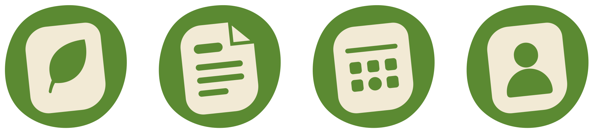
</p>

<h1 align="center">Unlease</h1>

<p align="center">
  <b>Stop leasing your data to Google, and unleash yourself.</b><br>
  Notes, documents, a calendar and contacts on your own server, in place of Google Keep, Docs, Calendar and Contacts.<br>
  One Docker container, apps for the web and Android, offline first.
</p>

<p align="center">
  <a href="https://demo.unlease.org/?lang=en"><b>Try the demo</b></a> ·
  <a href="#install">Install</a> ·
  <a href="https://github.com/stephenprn/unlease/releases/latest">Download</a> ·
  <a href="docs/README.md">Documentation</a> ·
  <a href="CHANGELOG.md">Changelog</a>
</p>

<p align="center">
  <a href="https://github.com/stephenprn/unlease/releases/latest"></a>
  <a href="https://github.com/stephenprn/unlease/actions/workflows/ci.yml"></a>
  <a href="LICENSE"></a>
  <a href="https://github.com/stephenprn/unlease/pkgs/container/unlease"></a>
</p>

<p align="center">
  <a href="https://demo.unlease.org/?lang=en"><picture><source media="(prefers-color-scheme: dark)" srcset="docs/images/banner-dark.jpg">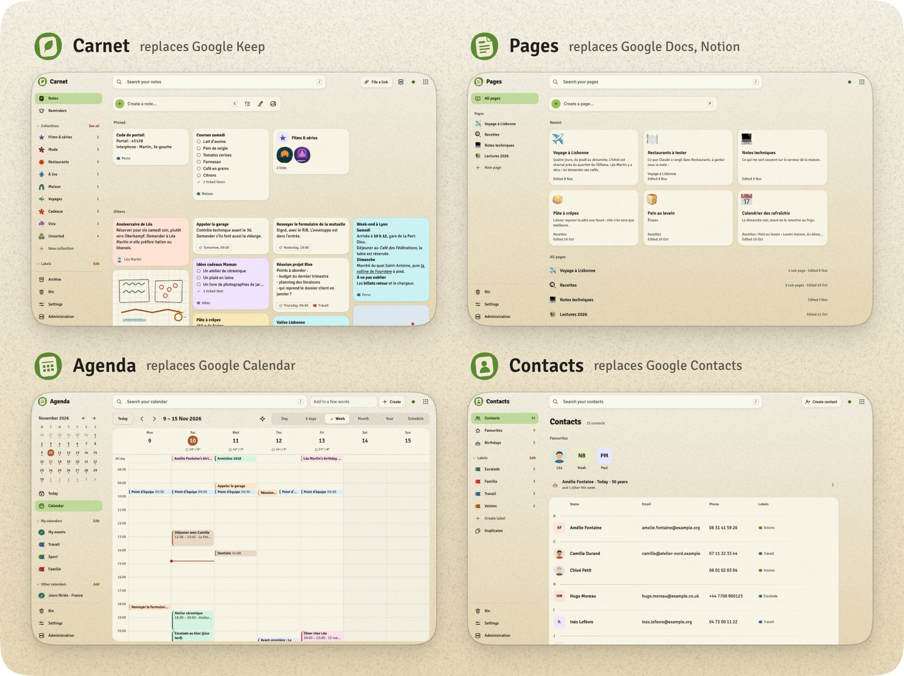</picture></a>
</p>

Unlease is four apps you run yourself, in place of Google's: **Carnet** for Keep, **Pages** for Docs and Notion, **Agenda** for Calendar and **Contacts** for Contacts. Your notes, documents, calendar and address book live in one place you own and on every device you use, and they keep working without a network. Take one app or all four: each stands on its own, and together they see into each other. A page cites a checklist, your contacts' birthdays show in your calendar, a note's reminder sits beside your meetings.

- **Modular.** Run one app or all four, and turn each on or off later in the Administration (its data is kept). On Android, install only the apps you want: each is its own APK.
- **One container on your homelab.** One Docker image for amd64 and arm64: a NAS, a Raspberry Pi 4 or 5, a small VPS. 1 GB of memory is comfortable. All your data is one SQLite file plus your photos, copied every day.
- **Offline first.** The Android apps keep everything on the phone and sync with your server when they reach it. Installed from your server, the web apps keep an offline copy too.
- **A server is optional.** Without one, an app keeps everything on that phone or in that browser, and you connect it to a server whenever you like.
- **Claude is optional.** With your own API key, the links you save are read, summarised and filed, and you can ask about your pages or your week, within a monthly budget you set. Without one, everything else works.
- **Private.** No analytics, no tracker, no Google service. Backups go to your own S3 storage as Markdown, JSON, vCard and iCalendar, which you can read without Unlease.

| What you need | Needed? | What it gives you |
| --- | --- | --- |
| An Android phone or a browser | Yes | The apps |
| The Unlease server (Docker) | No | Sync between your devices, the web apps at your address, backups, Claude |
| HTTPS in front of the server | For the Android apps | Phones refuse plain HTTP; browsers on your LAN are fine without it |
| Internet access | No | Only for what reads the web: links, Claude, public holidays, weather, place suggestions |
| A Claude API key | No | Links read and filed, answers about your pages and your week |
| S3 storage, Seafile | No | Backups away from home; photos and files in your Seafile library |

**Try it first:** [the demo](https://demo.unlease.org/?lang=en) runs the four web apps in your browser, with made-up notes, pages, people and events, in English or French. Nothing leaves your browser, and every reload starts afresh. The pictures below come from it.

> [!WARNING]
> Unlease is young (0.x). Until 1.0, a minor version (0.2 to 0.3) may break things, and the [changelog](CHANGELOG.md) says what to do. The Android apps are APKs from the [releases](https://github.com/stephenprn/unlease/releases/latest), not on a store.

## The apps

### 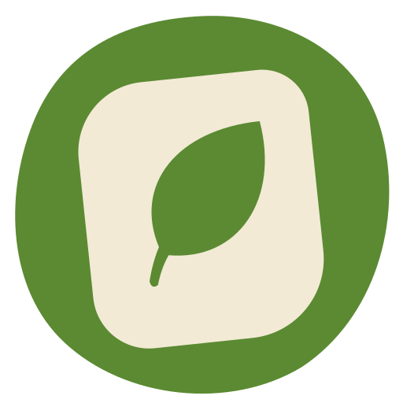 Carnet

**Replaces Google Keep.** Notes, checklists, drawings and reminders on a wall of cards, and collections of links that Claude reads, summarises and files: each link keeps its picture, its shop and its price, and says when the price drops.

<p align="center">
  <a href="https://demo.unlease.org/notes/?lang=en"><picture><source media="(prefers-color-scheme: dark)" srcset="docs/images/carnet-dark.jpg">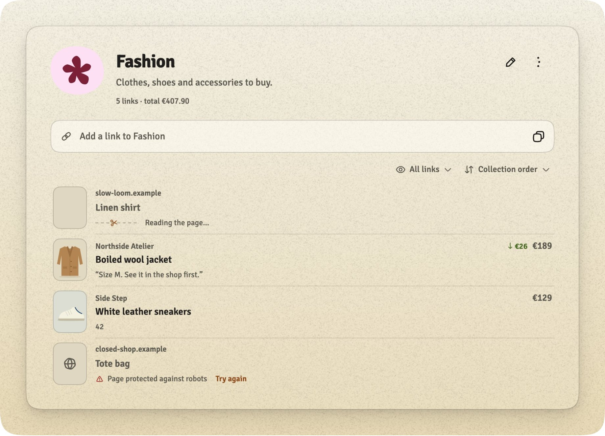</picture></a>
</p>

<details>
<summary><b>Everything Carnet does</b></summary>

- **Notes and checklists**, Keep's way: a wall of cards, pinned and archived, labels, colours and papers, reminders, photos, drawings, undo and a bin. Moves in from a Google Keep export (Takeout).
- **Collections of links**: share a link from any app, or paste it, and Claude writes what matters (title, price, key facts, its pictures kept) and files it in the right collection, so your lists stay useful after the pages disappear.
- **Modules on links**, switched on per collection: promo codes, the same item cheaper elsewhere or second-hand, a recipe for N people with its shopping list and a cook mode, ratings, a series' recap up to where you stopped, the way to a place, a copy of an article kept as a page in Pages, a question to Claude.
- **On Android**: the share sheet, with your collections in its first row; « Note in Carnet » on any selected text; shortcuts on the icon and a Quick Settings tile for a new note; five home-screen widgets; reminders that ring on time.

</details>

### 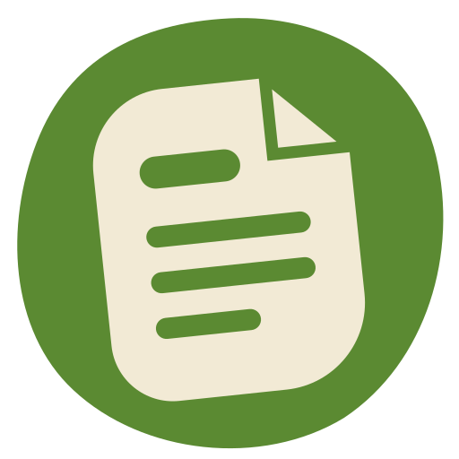 Pages

**Replaces Google Docs and Notion.** Nested pages of headings, tasks, tables with typed columns, pictures and drawings, citing and embedding your notes, links, people and events.

<p align="center">
  <a href="https://demo.unlease.org/pages/?lang=en"><picture><source media="(prefers-color-scheme: dark)" srcset="docs/images/pages-dark.jpg">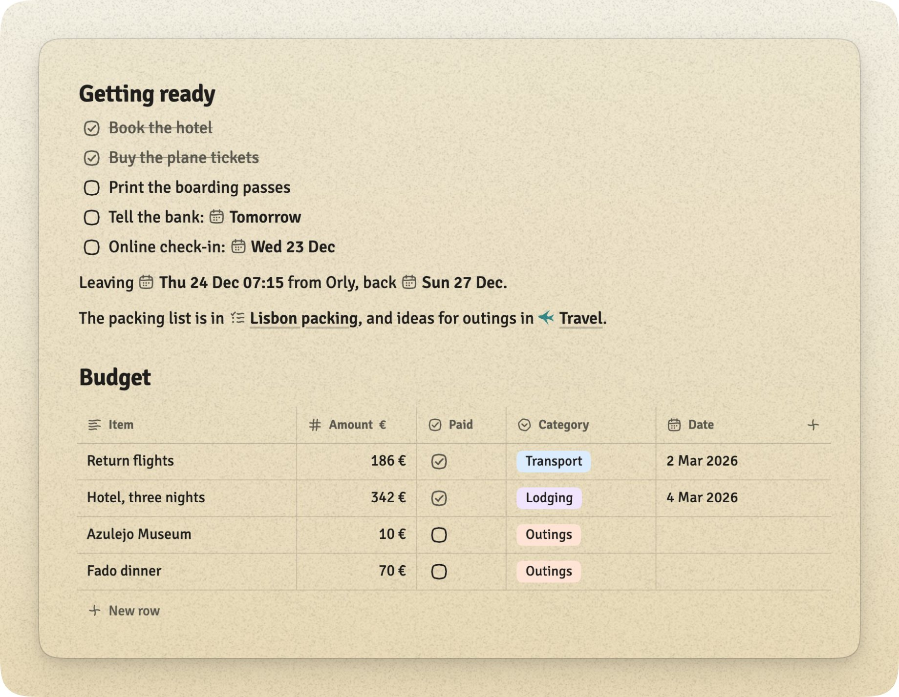</picture></a>
</p>

<details>
<summary><b>Everything Pages does</b></summary>

- **Nested pages** of headings, lists, tasks, toggles, callouts, code, tables with typed columns, side-by-side columns, pictures, videos, PDFs, files and drawings, with templates for a new page.
- **Your other apps inside**: Carnet's notes, collections and links cited inline or embedded as a list or a table; people and events mentioned with `@`; dates that show in Agenda.
- **Questions to Claude** about a page, its sub-pages or all your pages, each answer pointing at the passages it rests on. Off until you turn it on; a page you keep private is never sent.
- **Version history**: your server keeps each page's past versions (every one for a day, then one a day for 90 days), to read and restore.
- **On Android**: share text from any app as a new page; a new page or the search from the icon's shortcuts.

</details>

### 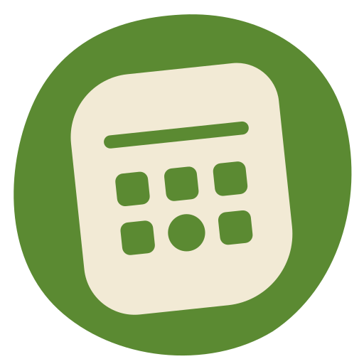 Agenda

**Replaces Google Calendar.** Every view from the day to the year, repeating events, reminders and subscriptions, with your contacts' birthdays, Carnet's reminders and the public holidays beside your events.

<p align="center">
  <a href="https://demo.unlease.org/agenda/?lang=en"><picture><source media="(prefers-color-scheme: dark)" srcset="docs/images/agenda-dark.jpg">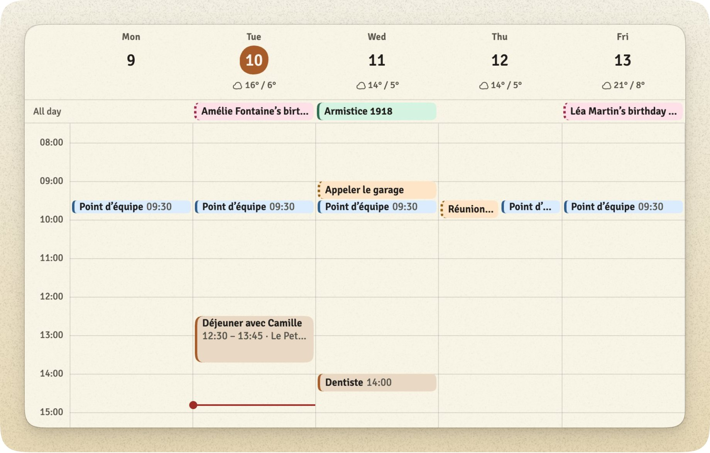</picture></a>
</p>

<details>
<summary><b>Everything Agenda does</b></summary>

- **Day, three days, week, month, year, a schedule and Today**; repeating events and their exceptions, reminders, time zones, labels, places with their weather, guests from Contacts, files kept with an event.
- **Beside your events**: your contacts' birthdays (with a message or a gift idea a tap away), Carnet's reminders, the days written in your pages and your country's public holidays.
- **Calendars in and out**: subscribe to any calendar by its address (Google's secret iCal address included), or with a login over CalDAV (your mailbox's, Nextcloud's, iCloud's), import Google Calendar's export, publish yours at a secret address. Type an event in a few words, or ask Claude about your week; a meeting's notes become a page in one tap.
- **On Android**: five widgets (the schedule, today, the month, the next event and a countdown); « Add to calendar » in your other apps opens Agenda's form, filled in; `webcal://` links subscribe; selected text becomes an event; a Quick Settings tile and the icon's shortcuts.

</details>

###  Contacts

**Replaces Google Contacts.** People, their numbers, addresses and birthdays, labels and favourites, moved in from Google; a call, a message or WhatsApp in one tap.

<p align="center">
  <a href="https://demo.unlease.org/contacts/?lang=en"><picture><source media="(prefers-color-scheme: dark)" srcset="docs/images/contacts-dark.jpg">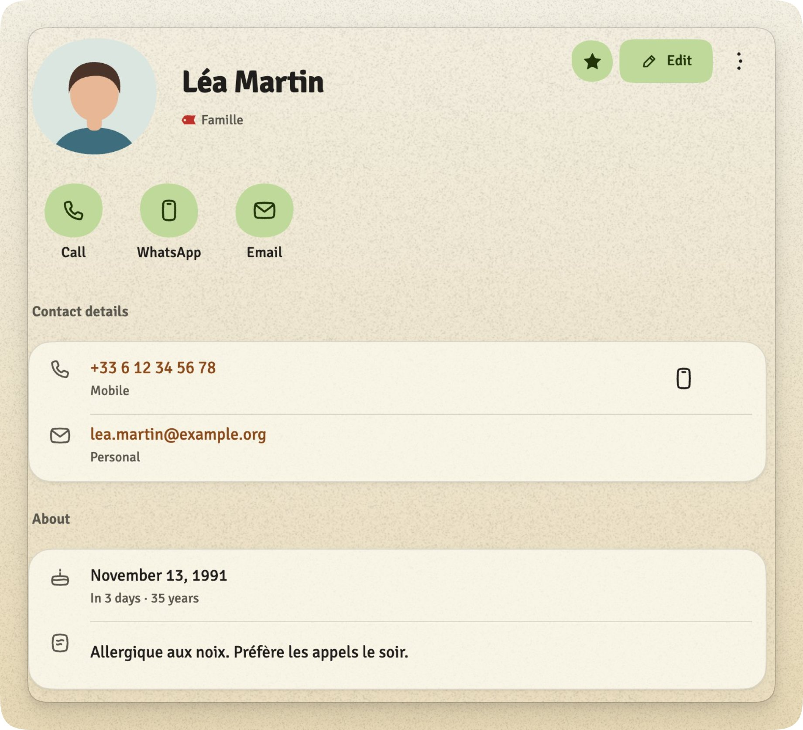</picture></a>
</p>

<details>
<summary><b>Everything Contacts does</b></summary>

- **An address book**: names, numbers, e-mails, addresses, birthdays, labels and favourites, imported from Google Contacts (vCard or CSV) or from the phone's own contacts; duplicates found and merged.
- **One tap** to call, text or open WhatsApp; birthday notifications and wishes; gift ideas kept in Carnet.
- **Where each person appears**: the pages and notes that mention them, the events you share.
- **On Android**: two widgets, quick calls to your favourites (or a label) and a new contact; « Add contact » in your dialer or Messages opens Contacts' form, filled in.

</details>

| | Carnet | Pages | Agenda | Contacts |
| --- | :-: | :-: | :-: | :-: |
| On the web | `/notes` | `/pages` | `/agenda` | `/contacts` |
| On Android | `carnet-vX.Y.Z.apk` | `pages-vX.Y.Z.apk` | `agenda-vX.Y.Z.apk` | `contacts-vX.Y.Z.apk` |
| Without a server | ✓ | ✓ | ✓ | ✓ |
| Home-screen widgets | 5 | – | 5 | 2 |
| Moves in from | Google Keep (Takeout) | – | Google Calendar (iCalendar) | Google Contacts (vCard, CSV), the phone |
| With Claude | reads and files links | answers about your pages | answers about your week | – |

## How the apps behave

The four apps are one suite: on the phone and on the web they look, move and answer alike, so what you learn in one works in the others.

<p align="center">
  <picture><source media="(prefers-color-scheme: dark)" srcset="docs/images/android-dark.jpg">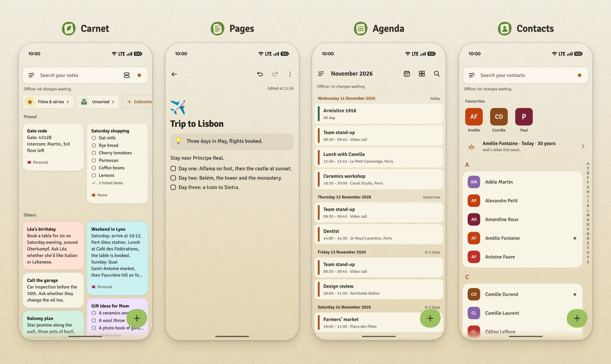</picture>
</p>

- **Content slides under the bars, it isn't sliced by them.** As a list or a form scrolls under a bar or a form's buttons, its edge gently dissolves, only while there is more beyond; where it simply runs off the screen, it just goes.
- **Every empty place says so**, and what fills it: a small paper collage on a whole screen, one line in a picker or a menu, both arriving with a little motion.
- **Gestures (Android):** a sheet follows your finger from anywhere and closes with a pull down; rows slide to act (a link done, a contact called or texted), clicking as they pass the point where they will act, and acting only when you let go; pull a list down to sync; Back closes what is open first, then a search or a narrowed list, then leaves.
- **Transitions:** going deeper slides in, a form rises over the screen, menus grow from where you opened them; what you remove fades and the rest close ranks, what you add settles in. Android's "Remove animations" and your browser's "Reduce motion" are honoured.
- **Keys (web):** `C` makes something new, `/` searches, `?` lists every key, `Esc` closes, `Ctrl`+`K` opens the spotlight, in every app.
- **On Android, part of the phone:** the share sheet (straight into a Carnet collection), selected text into a note or an event, "Add to calendar" and "Add contact" from your other apps, `webcal://` links, shortcuts on each icon, Quick Settings tiles, widgets, and icons that follow your wallpaper's themed style.

The full rules live in [DESIGN.md](DESIGN.md).

## How the apps work together

Each app keeps its own data, all of it on your one server, so each can show what the others hold. Type `@` in a page or a note to mention a person or an event; embed a checklist or a whole collection of links in a page; see birthdays, reminders and the days written in your pages in your calendar; open a contact to find everything that mentions them. A launcher in each app's corner moves between them, and on Android the second app you install reuses the first one's connection.

<picture>
  <source media="(prefers-color-scheme: dark)" srcset="docs/images/links-dark.jpg">
  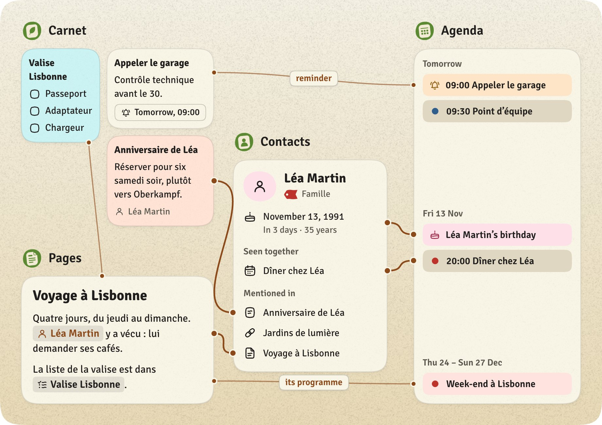
</picture>

## How it runs

One Docker container serves the sync, the API and the web apps on one port, behind the HTTPS you already have. The Android apps keep everything on the phone and sync when they can. Everything the server holds sits in one volume: the database, your photos and files, and a copy of the database every day. Claude, S3 and Seafile are optional, set from the apps' Administration.

<picture>
  <source media="(prefers-color-scheme: dark)" srcset="docs/images/run-dark.jpg">
  
</picture>

## Install

<picture>
  <source media="(prefers-color-scheme: dark)" srcset="docs/images/install-dark.jpg">
  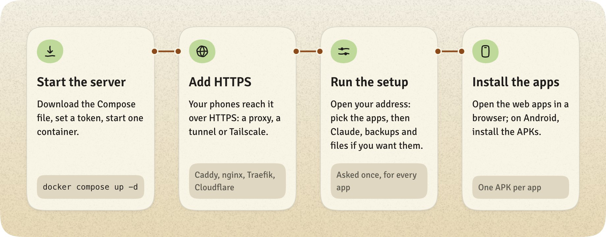
</picture>

### On your homelab or a VPS

You need a machine with Docker. One container runs the whole suite, whatever apps you choose.

1. **Start the server**:

   ```bash
   mkdir unlease && cd unlease
   curl -fsSLO https://github.com/stephenprn/unlease/releases/latest/download/docker-compose.yml
   curl -fsSL -o .env https://github.com/stephenprn/unlease/releases/latest/download/example.env
   sed -i "s/^UNLEASE_TOKEN=.*/UNLEASE_TOKEN=$(openssl rand -hex 32)/" .env   # your token, in .env
   docker compose up -d
   ```

2. **Add HTTPS** in front of port 8080, through the reverse proxy or tunnel you already run: [SELF-HOSTING.md](docs/SELF-HOSTING.md#https-in-front) has Caddy, nginx, Traefik and Cloudflare Tunnel.
3. **Run the setup**: open your address in a browser. It asks once, for every app: the token (`grep UNLEASE_TOKEN .env`), which apps to run, and optionally Claude, backups to S3 and files in Seafile. [Before you start](docs/SELF-HOSTING.md#before-you-start) lists everything it may ask and where you find it.
4. **Install the apps**: the web apps are already at your address. On Android, download the APK of each app you chose from the [latest release](https://github.com/stephenprn/unlease/releases/latest), open it on the phone (allow installing from your browser or file manager) and enter your server's address and token. Updates are new APKs from the releases, installed over the old ones.

<details>
<summary><b>Already run a Compose stack? Add the service to it</b></summary>

```yaml
services:
  unlease:
    image: ghcr.io/stephenprn/unlease:latest   # or a release, such as 0.1.1
    init: true
    restart: unless-stopped
    environment:
      UNLEASE_TOKEN: change-me                 # openssl rand -hex 32
      UNLEASE_DATA_DIR: /data
      TZ: Europe/Paris
    volumes:
      - unlease-data:/data
    ports:
      - "127.0.0.1:8080:8080"                  # your reverse proxy in front
volumes:
  unlease-data:
```

Every other setting is optional: [SELF-HOSTING.md](docs/SELF-HOSTING.md#settings) lists them.

</details>

**Back up** the volume's `backups/` and `blobs/` (never the live `unlease.sqlite`), or turn on Unlease's own S3 backups in the Administration: [your data](docs/SELF-HOSTING.md#your-data).

### On your LAN only, or without internet

- **LAN only:** browsers on your LAN use the web apps over plain HTTP. The Android apps need HTTPS with a certificate Android trusts: Tailscale's, or one for a name you own (Let's Encrypt's DNS challenge issues one for a name only your LAN resolves). See [without a public address](docs/SELF-HOSTING.md#without-a-public-address).
- **Without internet:** the server needs no account, no licence and no outside service to run. Bring the image in with `docker save` and `docker load`, copy the APKs to the phones, and everything works except what reads the web (links, Claude, holidays, weather). See [without internet access](docs/SELF-HOSTING.md#without-internet-access).
- **Without a server:** open a web app or install an APK and choose « Keep everything in this browser » or « Keep everything on this phone ». Connect a server later from the Administration.

## Upgrade

Read the [changelog](CHANGELOG.md) up to the new version, then upgrade the server first: set `UNLEASE_VERSION` to it in `.env` and run `docker compose pull && docker compose up -d`. Then install the release's APKs; the web apps update with the server. [UPGRADING.md](docs/UPGRADING.md) explains why the server goes first, the version tags, and how to go back.

## Claude, costs and privacy

Claude is optional: without an API key every app works, Carnet keeps links as they are, unread, and the questions to Claude stay off. With a key (set once for every app, kept on your server, the only part that talks to Anthropic), a link costs roughly one to three cents to read, the server stops at the monthly budget you set, and your notes and pages are never sent to read a link.

<picture>
  <source media="(prefers-color-scheme: dark)" srcset="docs/images/privacy-dark.jpg">
  
</picture>

[PRIVACY.md](docs/PRIVACY.md) lists what each feature sends, to whom, when, and what it costs.

## Documentation

| | |
| --- | --- |
| [Self-hosting](docs/SELF-HOSTING.md) | Proxies, every setting, your data, backups, a LAN without internet |
| [Upgrading](docs/UPGRADING.md) | Versions, the server first, going back |
| [Privacy and costs](docs/PRIVACY.md) | What leaves your server, when, and what Claude costs |
| [Architecture](docs/ARCHITECTURE.md) | The suite, its apps and their data across apps, sync, Carnet's link reading |
| [Server API](server/README.md) | Every route, the configuration, the data on disk |
| [Changelog](CHANGELOG.md) | What changed in each release |

The full map, by what you need, is [docs/README.md](docs/README.md).

## Contributing

Issues and pull requests are welcome, in English or French. One repository holds the server, every app and the shared design system; to try a change, run the web apps on a server simulated in the page:

```bash
npm install
npm run dev -w web    # then open http://localhost:5173/notes?demo
```

[CONTRIBUTING.md](CONTRIBUTING.md) sets up the rest (the phone apps: [mobile/README.md](mobile/README.md)) and lists the checks. Please follow the [code of conduct](CODE_OF_CONDUCT.md); report a vulnerability privately as [SECURITY.md](SECURITY.md) says; [SUPPORT.md](SUPPORT.md) says where to ask a question. The README's pictures come from the demo and the design system: `npm run readme-images -w web` makes them again.

## Licence

[MIT](LICENSE).
