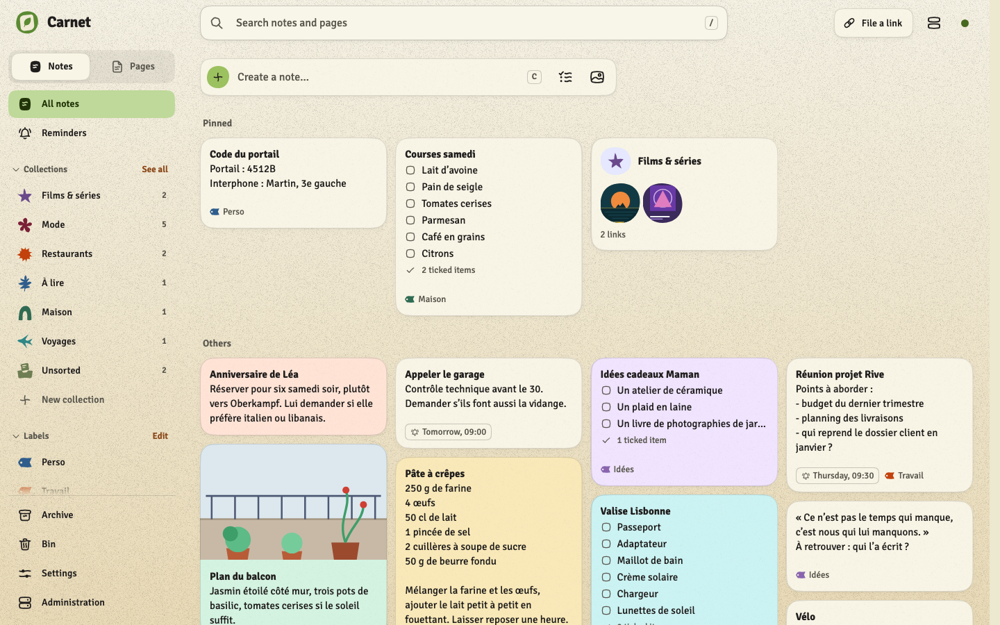
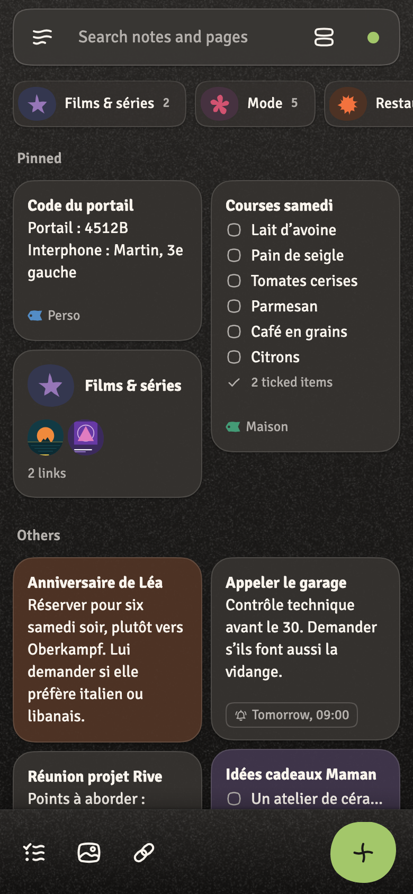
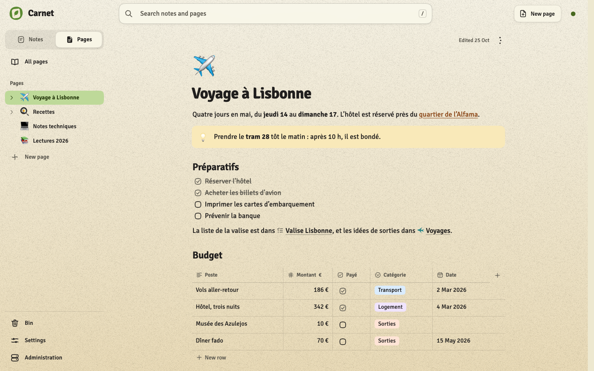

# Unlease

[](https://github.com/stephenprn/unlease/actions/workflows/ci.yml)
[](https://github.com/stephenprn/unlease/releases/latest)
[](LICENSE)

Stop leasing your data to Google, and unleash yourself. Unlease is a suite of apps that replaces Google's, on your own server. You choose which apps your server runs; they share one server, one setup, one look, your settings (Claude, backups, files) and data that points from one app into another (a page cites a note or a whole collection of links). No Google service, no analytics, no tracker.

Your data stays yours: one server you run, one SQLite file, backups to any S3 storage as a readable archive (Markdown and JSON), and your photos and files in a Seafile library if you want them there.

**Try it in your browser:** [the demo](https://stephenprn.github.io/unlease/), the four web apps with made-up notes, pages, people and events. Nothing leaves the browser, and every reload starts afresh.

> **Status: early (0.x).** Each release is one version for the server and every app. Until 1.0, a minor version (0.2 to 0.3) may break things; the [changelog](CHANGELOG.md) says what to do.

<p>
  
  
</p>


## The apps

| App | Replaces | On the web | On Android |
| --- | --- | --- | --- |
| **Carnet**: notes, lists and links | Google Keep | `/notes` | `carnet-vX.Y.Z.apk` |
| **Pages**: nested pages, a wiki | Google Docs, Notion | `/pages` | `pages-vX.Y.Z.apk` |
| **Agenda**: a calendar | Google Calendar | `/agenda` | `agenda-vX.Y.Z.apk` |
| **Contacts**: people, birthdays, labels | Google Contacts | `/contacts` | `contacts-vX.Y.Z.apk` |

**Carnet** is a self-hosted Google Keep with one difference that matters: every link you save is read by Claude, summarised (title, price, key facts, its pictures kept) and filed in the right collection, so your lists stay useful after the pages disappear.

- **Notes and checklists**, Keep's way: a wall of cards, pinned and archived, labels, colours and papers, reminders, photos, drawings, a bin. Imports a Google Keep export (Takeout).
- **Collections of links**: share a link from any app (or paste it) and Claude writes what matters and files it. Each collection can show small modules on its links: promo codes, the same item cheaper elsewhere or second-hand, a recipe for N people with its shopping list and a cook mode, ratings, a series' recap up to where you stopped, the way to a place, a copy of an article kept as a page in Pages, a question to Claude.

**Pages** is a knowledge base: nested pages, headings, lists, tasks, toggles, callouts, code, tables with typed columns, columns, pictures, videos, PDFs and files, drawings, and Carnet's notes, collections and links cited inline or embedded as a list or a table. Claude can answer questions about your pages, citing them.

**Contacts** is an address book: names, numbers, e-mails, addresses, birthdays, labels and favourites, imported from Google Contacts (its export, or the phone's own contacts on Android). Call, text or open WhatsApp from a contact; mention people in Pages. On Android, two widgets: quick calls to your favourites (or a label) and a new contact.

**Agenda** is a calendar, Google Calendar's way: day, three days, week, month, year and a schedule; repeating events (and their exceptions), reminders, time zones, labels, places with their weather, guests from your contacts, files kept with the event, and a description that mentions pages, notes and people. Your contacts' birthdays show in it (with WhatsApp, a message or a gift idea a tap away), so do Carnet's reminders and the days written in your pages; the public holidays of your country come from Nager.Date. Subscribe to any calendar by its address (Google's secret iCal address included), import Google Calendar's export, publish your own at a secret address, type an event in a few words, or ask Claude about your week. Pages and Carnet mention events and list the events that mention them; a meeting's notes are a page in one tap. On Android, four widgets: the schedule, the month, the next event, and a countdown to an event you choose.

All four work **offline first** on Android (Carnet also has the share sheet, five home-screen widgets and reminders as notifications) **and on the web**: each its own web app, served by your server and installable on its own, with the Administration in reach and keyboard shortcuts. In French or English, in the colours you pick.

## Install

You need a machine with Docker that your phone can reach over **HTTPS** (a home server behind a reverse proxy or a tunnel, or a small VPS). One container runs the whole suite, whatever apps you choose.

```bash
mkdir unlease && cd unlease
curl -fsSLO https://github.com/stephenprn/unlease/releases/latest/download/docker-compose.yml
curl -fsSL -o .env https://github.com/stephenprn/unlease/releases/latest/download/example.env
sed -i "s/^UNLEASE_TOKEN=.*/UNLEASE_TOKEN=$(openssl rand -hex 32)/" .env   # your token, in .env
docker compose up -d
```

Put HTTPS in front of port 8080 ([docs/SELF-HOSTING.md](docs/SELF-HOSTING.md) has Caddy, nginx, Traefik and Cloudflare Tunnel), then open your address in a browser. The setup asks once, for every app: the token (`grep UNLEASE_TOKEN .env`), which apps to run, and optionally Claude, backups to S3, files in Seafile. [SELF-HOSTING.md](docs/SELF-HOSTING.md#before-you-start) lists everything it may ask and where you find it.

**On Android:** download the APK of each app you chose from the [same release](https://github.com/stephenprn/unlease/releases/latest) (`carnet-vX.Y.Z.apk`, `pages-vX.Y.Z.apk`, `contacts-vX.Y.Z.apk`, `agenda-vX.Y.Z.apk`), open it on the phone (allow installing from your browser or file manager) and enter your server's address and token; each app you install after the first offers to reuse its connection. They are not on a store: updates are new APKs from the releases, installed over the old ones.

## Upgrade

Read the [changelog](CHANGELOG.md) up to the new version, then upgrade the server first: set `UNLEASE_VERSION` to it in `.env` and run `docker compose pull && docker compose up -d`. Then install the release's APKs; the web apps update with the server. [docs/UPGRADING.md](docs/UPGRADING.md) explains why the server goes first, the version tags, and how to go back.

## Claude, costs and privacy

Claude is optional: without an API key every app works, Carnet keeps links as they are, unread, and Pages answers no questions. With a key (set once for every app, from the setup or the Administration, kept on your server, which is the only part that talks to Anthropic), a link costs roughly one to three cents to read, the server stops at the monthly budget you set, and your notes and pages are never sent to read a link. [docs/PRIVACY.md](docs/PRIVACY.md) lists what each feature sends and what it costs.

## Documentation

| | |
| --- | --- |
| [Self-hosting](docs/SELF-HOSTING.md) | Proxies, every setting, your data, backups, hosting a web app elsewhere |
| [Upgrading](docs/UPGRADING.md) | Versions, the server first, going back |
| [Privacy and costs](docs/PRIVACY.md) | What leaves your server, when, and what Claude costs |
| [Architecture](docs/ARCHITECTURE.md) | The suite, its apps and their data across apps, sync, Carnet's link reading |
| [Server API](server/README.md) | Every route, the configuration, the data on disk |
| [Changelog](CHANGELOG.md) | What changed in each release |

The full map, by what you need, is [docs/README.md](docs/README.md).

## Contributing

Issues and pull requests are welcome, in English or French: [CONTRIBUTING.md](CONTRIBUTING.md) sets up the repository (one for the server, every app and the shared design system; [mobile/README.md](mobile/README.md) for the phone apps) and lists the checks. Please follow the [code of conduct](CODE_OF_CONDUCT.md); report a vulnerability privately as [SECURITY.md](SECURITY.md) says; [SUPPORT.md](SUPPORT.md) says where to ask a question.

## Licence

[MIT](LICENSE).
